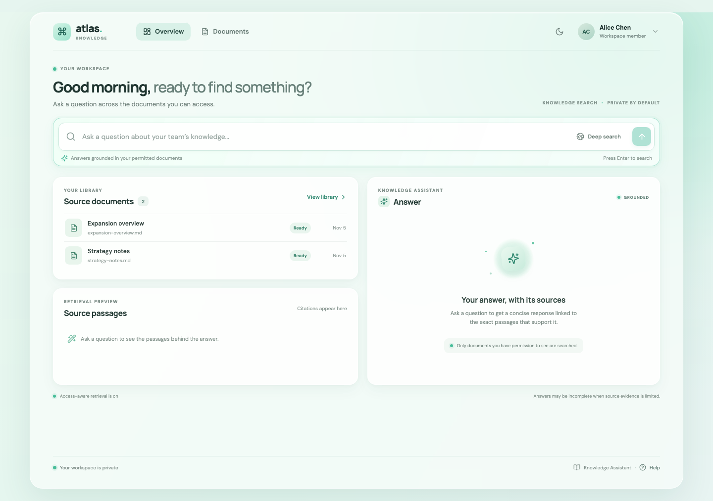
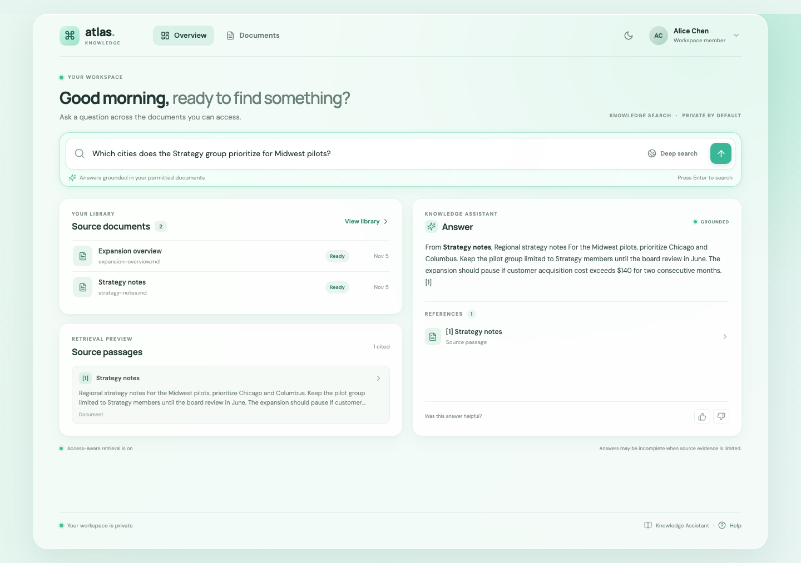
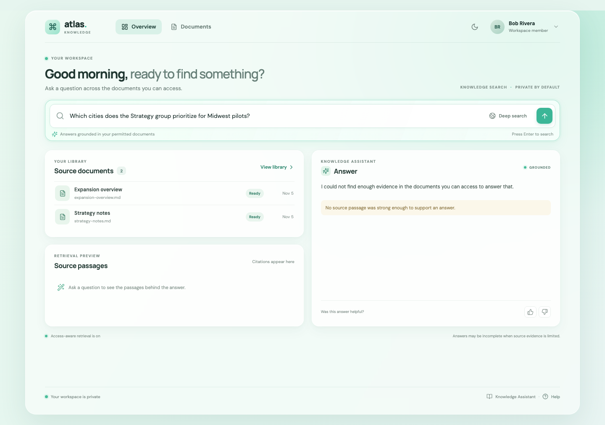
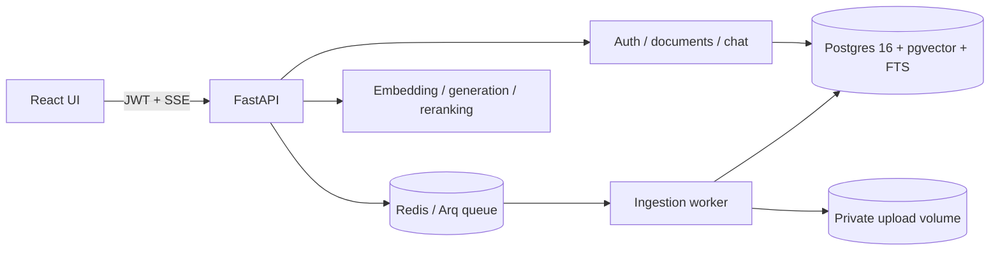
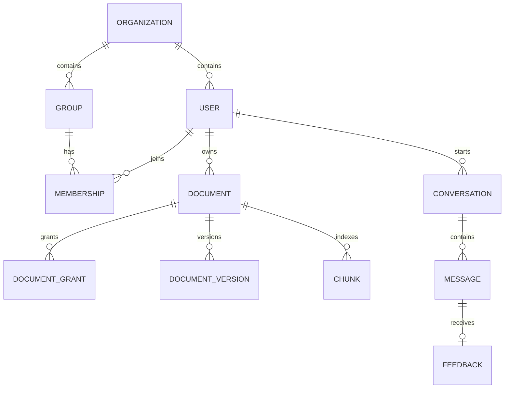

# Atlas · Enterprise Knowledge Assistant

[](https://github.com/MazenElharmeel-spec/enterprise-rag-knowledge-assistant/actions/workflows/ci.yml)

An end-to-end, permission-aware retrieval-augmented generation (RAG) application. Users upload documents, search only sources their account can access, and receive streamed answers with validated source citations. This repository contains a runnable local demo, synthetic sample documents, API documentation, and tests.

## Product screenshots

These screenshots come from the running local application and use synthetic demo data.

| Workspace | Alice: cited answer | Bob: evidence-based abstention |
|---|---|---|
|  |  |  |


## Try the permission-aware demo

1. Start the stack and seed its synthetic documents using the installation steps below.
2. Sign in as Alice (`alice@acme-demo.com` / `demo-pass-123`) and ask: “Which cities does the Strategy group prioritize for Midwest pilots?” Alice can cite the Strategy group document.
3. Sign out, sign in as Bob (`bob@acme-demo.com` / `demo-pass-123`), and ask the same question. Bob cannot access that document, so the app abstains without a citation.

The demo runs locally in Docker Compose; there is no hosted public demo yet. The checked-in corpus is synthetic and contains no confidential data.

## Quickstart

Requirements: Docker Compose v2. From the repository root:

```sh
cp .env.example .env
docker compose up --build -d
docker compose exec api python -m backend.app.scripts.seed
```

Open [http://localhost:5173](http://localhost:5173). All demo accounts use `demo-pass-123`:

- `alice@acme-demo.com` — Strategy member; sees org, group, and her private documents.
- `bob@acme-demo.com` — member; sees org documents only.
- `admin@acme-demo.com` — workspace administrator and Strategy member.

Ask “Which cities does the Strategy group prioritize for Midwest pilots?” as Alice and Bob. Alice receives a Strategy Notes citation; Bob gets an evidence-based abstention because that group document is outside his access. `make seed` can be run again safely. Use `docker compose down` to stop services; add `-v` only when you also want to remove database and uploaded files.

For local Python work, install [uv](https://docs.astral.sh/uv/), then run `uv sync --all-groups`, `uv run pytest`, `uv run ruff check backend`, and `uv run mypy backend`. For the frontend: `cd frontend && npm ci && npm run dev`.

## Architecture



The app follows API-to-service-to-SQL-to-database boundaries; ingestion and provider interfaces run independently of FastAPI. PostgreSQL RLS checks the request user, organization, and groups. Retrieval SQL repeats the ACL overlap check before vector and lexical ranking/limits.



## Features

- JWT access/refresh auth, Argon2id password hashing, member/admin roles, organization groups, and document ACLs.
- Upload and re-version PDF, DOCX, Markdown, HTML, and TXT. Uploads have size/type checks, SHA-256 deduplication for the same owner, ingestion states, retries, and soft deletion.
- Parsing preserves headings, PDF pages, and tables. Chunks store source offsets and embedding model/version.
- Hybrid vector + full-text retrieval uses RRF, optional cross-encoder/LLM reranking, duplicate suppression, deep-search top-k, SQL ACL pre-filtering, and RLS.
- SSE answers finish with server-validated citations. Unsupported/uncited output is replaced with abstention.
- React login, chat, document library/access editor/viewer, settings, admin overview, feedback, responsive layout, and dark mode.

## Example dataset

`data/demo/` contains three synthetic Markdown documents used by the seed script. They demonstrate organization-wide, group-restricted, and owner-private access. Do not replace these with confidential files in a public repository.

## Configuration

Copy `.env.example` to `.env`. Defaults use `EMBEDDING_PROVIDER=fake` and `LLM_PROVIDER=fake`. Set `EMBEDDING_PROVIDER=openai` and `OPENAI_API_KEY` for `text-embedding-3-small`. `EMBEDDING_PROVIDER=local` selects `sentence-transformers/all-MiniLM-L6-v2` after `uv sync --extra local-embedding`. Set `LLM_PROVIDER=anthropic` and `ANTHROPIC_API_KEY` for generation. `RERANKER_PROVIDER` supports `lexical` (default), `cross-encoder` (install `--extra cross-encoder`), and `llm` (Anthropic key).

## API

Interactive OpenAPI/Swagger UI: [http://localhost:8000/docs](http://localhost:8000/docs). Route notes and example request shapes are in [docs/api.md](docs/api.md).

| Route | Purpose |
|---|---|
| `POST /api/v1/auth/login`, `POST /auth/refresh`, `GET /auth/me` | Authentication |
| `GET/POST /api/v1/documents`, `GET /documents/{id}`, `POST /documents/{id}/versions` | Library and uploads |
| `PUT /api/v1/documents/{id}/acl`, `POST /documents/{id}/retry`, `DELETE /documents/{id}` | Access and re-index |
| `POST /api/v1/chat/ask` | SSE answer (`meta`, `token`, `citations`, `done`) |
| `GET /api/v1/chat/conversations`, `GET /chat/conversations/{id}` | Conversation history |
| `POST /api/v1/chat/messages/{id}/feedback` | Feedback |
| `GET /api/v1/admin/overview`, `/admin/users`, `/admin/groups` | Admin views |
| `GET /health/live`, `/health/ready`, `/metrics` | Health and Prometheus export |

## Security model

Passwords use Argon2id. Signed access and refresh tokens include user and organization IDs. Authenticated routes resolve an active user and set transaction-local `app.user_id`, `app.organization_id`, and `app.group_ids`. The chunks table has forced RLS; search SQL also checks principal arrays (`user:<uuid>`, `group:<uuid>`, `org:<uuid>`) before ranking. Citations can only reference authorized retrieved chunks; invalid markers are stripped. Retrieved document text is untrusted prompt context. API keys are read from the environment.

## Evaluation

Run `make eval` after `make seed`. The CLI uses 40 fixed questions (30 answerable over the seeded corpus, 10 that should be declined), compares vector-only, hybrid RRF, and hybrid plus reranking, and reports recall@5, MRR, nDCG, citation precision, groundedness, abstention accuracy, and p50/p95 retrieval latency. `docs/eval-report.md` is updated with measured output after a local run. CI runs the two-user permission smoke path against Compose.

## Tests and CI

Run `make test` for backend and frontend checks. The GitHub Actions workflow runs Python lint/type checks/tests, frontend build/tests/lint, and the Compose permission smoke test. The current suite includes unit coverage for structure-aware chunking and citation validation, a React login test, and a live two-user ACL smoke test.

## Documentation and decisions

- [Architecture](docs/architecture.md) · [API notes](docs/api.md) · [Evaluation](docs/eval-report.md)
- [Architecture decision records](docs/adr/)

## Known limits

- Fake embeddings are deterministic token hashing, not semantic embeddings. Production use needs OpenAI or local embeddings followed by a re-index.
- Admin user/group provisioning is API-first; the React admin page currently focuses on metrics and members.
- Antivirus is a pluggable interface with a no-op demo implementation. Connect a scanner before accepting untrusted external uploads.
- The PDF viewer scrolls to the cited page and shows the extracted passage beside it; it does not draw per-character overlays onto the source PDF.
- Refresh tokens expire but are not server-side revocable/rotating.
- Observability includes structured request logs, request IDs, readiness, Prometheus export, and optional OpenTelemetry traces for FastAPI, SQLAlchemy, and HTTPX; detailed token/cost metrics remain an extension point.
- No production identity provider, cloud object store, or external web search is bundled.

## What I would do next

Add refresh-token rotation, a real antivirus adapter, identity-provider provisioning, encrypted object storage and retention policies, broader adversarial Postgres integration tests, detailed token/cost metrics, and a larger human-reviewed evaluation corpus before production use.
